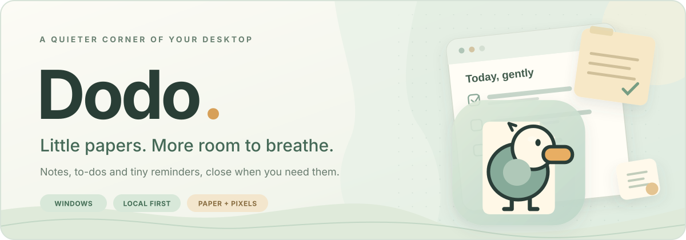
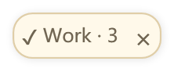
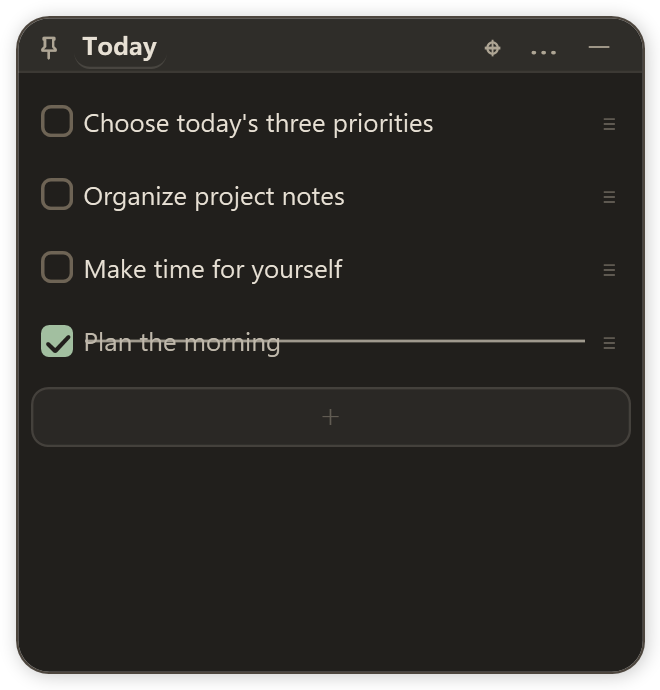
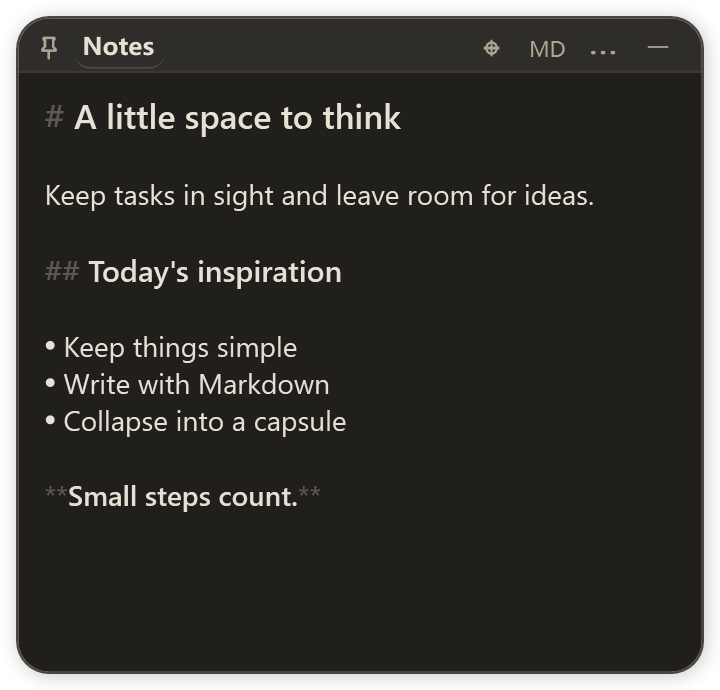

<p align="center">
  <a href="https://github.com/seiya058904/dodo/releases/latest">
    
  </a>
</p>

<h1 align="center">Dodo</h1>
<p align="center"><strong>A few useful papers. A little more breathing room.</strong></p>
<p align="center">
  Notes, to-dos and tiny reminders that live on your Windows desktop.<br />
  Open a paper, finish a thought, then tuck it into the edge of your screen.
</p>

<p align="center">
  <a href="https://github.com/seiya058904/dodo/releases/tag/v0.1.0"></a>
  
  
  <a href="LICENSE.md"></a>
</p>

<p align="center">
  <a href="https://github.com/seiya058904/dodo/releases/latest"><strong>📦 Download for Windows</strong></a>
  &nbsp;·&nbsp; <a href="README.zh.md">简体中文</a>
  &nbsp;·&nbsp; <a href="#gallery">Screenshots</a>
  &nbsp;·&nbsp; <a href="#download">Get started</a>
  &nbsp;·&nbsp; <a href="https://github.com/seiya058904/dodo/issues">Feedback</a>
</p>
<p align="center"><sub>Native WPF · Local-first · Portable profile · No account or note-cloud service</sub></p>

<a id="gallery"></a>

## 🪟 A desktop with room to think

<table>
  <tr>
    <td width="50%" valign="top"></td>
    <td width="50%" valign="top"></td>
  </tr>
  <tr>
    <td align="center"><strong>☑️ A little list</strong><br /><sub>Make progress, one checkmark at a time.</sub></td>
    <td align="center"><strong>📝 A little note</strong><br /><sub>Catch an idea before it flies away.</sub></td>
  </tr>
</table>

<sub>These are actual Windows screenshots, cropped and masked only to remove the surrounding desktop.</sub>

<p align="center">
  <br />
  <sub>When a paper needs a break, dock it as an edge capsule — with an optional unfinished-task count.</sub>
</p>

<details>
<summary><strong>🌙 After hours — see Dodo in dark mode</strong></summary>

<table>
  <tr>
    <td width="50%"></td>
    <td width="50%"></td>
  </tr>
</table>

<sub>The dark-mode and capsule previews are renders of real WPF controls from the included offscreen review tool, not physical-desktop/DWM screenshots. The <a href="doc/DODO-VERIFICATION.md">verification record</a> explains the actual desktop checks and remaining gaps.</sub>

</details>

<a id="features"></a>

## 🌿 Small things, thoughtfully done

<table>
  <tr>
    <td width="50%" valign="top">
      <h3>📝 Notes that feel like paper</h3>
      <p>Lightweight Markdown, local images, undo and a simple place to put a passing thought.</p>
    </td>
    <td width="50%" valign="top">
      <h3>☑️ To-dos without the fuss</h3>
      <p>Check off tasks, reorder a list, set reminders and pick up where you left off.</p>
    </td>
  </tr>
  <tr>
    <td width="50%" valign="top">
      <h3>🧷 Papers that tuck away</h3>
      <p>Dock a paper at the screen edge. Built-in to-do capsules can show a quiet <code>Work · 3</code> reminder.</p>
    </td>
    <td width="50%" valign="top">
      <h3>📦 Yours to keep</h3>
      <p>Local files, portable ZIP backups and Markdown exports. No Dodo account or hosted notes service.</p>
    </td>
  </tr>
</table>

Dodo is built on **[PaperTodo](https://github.com/snownico0722/PaperTodo)**. The original project provides the native paper windows, edge docking, Markdown editing, undo, search, multilingual UI, plugin system and MCP integration. **Dodo's additions** are deliberately focused:

- **A gentler to-do capsule.** See unfinished counts update after edits, completion, deletion and undo. Counts disappear at zero and can be turned off.
- **A way out, and a safe way back.** Create a versioned ZIP backup of your profile, or validate and restore one with a preserved rollback copy.
- **Markdown you can take with you.** Export notes and checklists to `.md`, with relative image assets and preserved checkbox states.
- **A home of its own.** Independent executable, local data directory, startup registration, single-instance signals and MCP pipe; the upstream telemetry sender and reporting tasks are removed.
- **A softer finish.** Dodo's little bird, sage accents, improved secondary-text contrast and coordinated light/dark styling.

<sub>Available interface languages: English · 简体中文 · 日本語 · 한국어. Edge hover previews, third-party plugins and MCP retain their upstream <strong>preview</strong> status.</sub>

<a id="download"></a>

## 📦 Come on in

Choose the **v0.1.0** Windows x64 ZIP that fits your setup:

| Download | For whom |
| --- | --- |
| **[Portable ZIP · .NET included](https://github.com/seiya058904/dodo/releases/download/v0.1.0/Dodo-v0.1.0-win-x64-portable.zip)** · ~78 MiB | **Recommended.** Extract and run, without installing a separate .NET runtime. |
| [Smaller ZIP · no runtime](https://github.com/seiya058904/dodo/releases/download/v0.1.0/Dodo-v0.1.0-win-x64-no-runtime.zip) · ~10.3 MiB | For PCs that already have **.NET 10 Desktop Runtime x64**. |
| [SHA256SUMS.txt](https://github.com/seiya058904/dodo/releases/download/v0.1.0/SHA256SUMS.txt) | Verify the published archives. |

1. **Download** one of the packages above, or visit the [latest releases](https://github.com/seiya058904/dodo/releases/latest).
2. **Extract the entire ZIP** to a writable folder and open **`Dodo.exe`**.
3. **Keep `dodo-data/`** beside the executable when updating. That's where your portable profile lives.

**Compatibility:** Windows x64. The Windows API target is Windows 10 version 1809, while actual runtime support follows the [Microsoft .NET 10 OS matrix](https://github.com/dotnet/core/blob/main/release-notes/10.0/supported-os.md). The documented local tests used Windows 11; **Windows 10 has not been separately verified**. Packages are unsigned, so Windows may show a reputation warning.

The portable package bundles the native **Focus Timer** and **Sample Clock** plugins. Other sample plugins are not automatically included. Web-based plugins additionally need **WebView2 Evergreen Runtime**; normal notes, to-dos and bundled native plugins do not.

<details>
<summary><strong>⌨️ Handy gestures and shortcuts</strong></summary>

| You want to… | Do this |
| --- | --- |
| Fold a paper into an edge capsule | Top-right paper button or `Ctrl+W` |
| Undo / redo a change | `Ctrl+Z` / `Ctrl+Y` |
| Search papers or their text | Tray menu → Search |
| Bring hidden papers forward | Double-click the tray icon |
| Save a paper as Markdown | Paper menu **⋯ → Export Markdown…** |
| Back up or restore your profile | **Settings → General → Backup and restore** |

</details>

<a id="data"></a>

## 🔒 Your papers stay yours

Dodo stores notes locally. **There is no account, automatic cloud sync or hosted notes service.** It does not automatically import an existing PaperTodo profile; the two apps can coexist.

**Backups restore by replacement, not by merging.** Before restoring, Dodo validates the ZIP and shows a summary for confirmation. It preserves your previous profile under `dodo-data/restore-history/`, applies the replacement and exits. Reopen Dodo to load the restored data. A restore interrupted mid-way is rolled back at the next startup.

**Markdown export is one-way.** Keep the exported `.md` file and its accompanying `dodo-assets-…` image folder together. Edits made to exported files do not flow back into Dodo.

<details>
<summary><strong>What goes into a backup? What stays out?</strong></summary>

The versioned archive includes `data.json`, its recovery snapshot, `note-assets.lmdb`, host-managed `plugins/data/*.json`, background preferences, and supported `dodo.*` custom image, font, sound and icon resources.

It does **not** bundle plugin executables, plugin-owned external databases, linked files outside the profile, caches or older restore-history folders. A restore lists required plugins; reinstall any missing plugin programs before using their restored state. Archives can contain private notes and plugin settings — review them before sharing.

Dodo checks archive format and version, hashes, paths, image references and plugin-state files before replacing a profile. Re-exporting Markdown to the same filename asks before overwrite and uses a fresh assets directory rather than deleting earlier exported images.

</details>

<a id="development"></a>

## 🛠️ Build a little bird

**Windows · PowerShell 7 · Git · .NET 10 SDK**

```powershell
git clone --recurse-submodules https://github.com/seiya058904/dodo.git
cd dodo
dotnet build PaperTodo.csproj -c Release
```

`PaperTodo.csproj` and some internal namespaces intentionally retain upstream-compatible names; the desktop application is **`Dodo.exe`**. If the checkout is missing dependencies, run `git submodule update --init --recursive`. GitHub-generated source ZIPs do **not** contain the submodule, so they are not standalone build packages.

<details>
<summary><strong>Checks, packaging and engineering notes</strong></summary>

```powershell
./tools/testing/Run-Checks.ps1 -Group persistence
dotnet run --project tests/PaperTodo.EdgeTitleChecks -c Release -- --todo-count-only
dotnet run --project tests/PaperTodo.MarkdownEditingChecks -c Release -- --export
./tools/Release.ps1
```

Some test groups open real Windows test windows. The release workflow rebuilds native LMDB from the repository's included source and requires **CMake** and the **Visual C++ toolchain**. Publication is a manually dispatched workflow following tests and desktop acceptance — pushing a Git tag alone does not publish a release.

</details>

**Further reading:** [Verification & limitations](doc/DODO-VERIFICATION.md) · [Architecture](doc/ARCHITECTURE.md) · [Plugin documentation](plugin-samples/README.md) · [Changelog](CHANGELOG.md).

<a id="credits"></a>

## 🐤 A note of thanks

Dodo is a **noncommercial, source-available derivative** of [PaperTodo](https://github.com/snownico0722/PaperTodo), based on upstream commit `411078b094f9a22c15ffb2722f0b1cc7d0af0537` (`4.0.0-beta1`). It preserves the original history and authorship. Dodo `0.1.0` has its own version sequence; it does **not** mean every inherited preview feature is production-stable.

Thanks to **snownico0722** and the PaperTodo contributors for the paper-first idea and native desktop foundation.

**License:** [PolyForm Noncommercial 1.0.0 and PaperTodo Individual Professional Use Additional Permission 1.0](LICENSE.md). This is **not** MIT-licensed or OSI-approved open source; organizational use has additional restrictions. Please read the full [LICENSE.md](LICENSE.md), [Required Notice](REQUIRED-NOTICE.md) and [third-party notices](THIRD-PARTY-NOTICES.md) before using or redistributing it.

---

<p align="center">
  <br />
  <em>One small paper at a time.</em><br />
  <a href="https://github.com/seiya058904/dodo/releases/latest"><strong>Find your Dodo ↗</strong></a>
  &nbsp;·&nbsp; <a href="#dodo">Back to top ↑</a>
</p>

---

<!-- BEGIN GENERATED CHINESE README -->
<details>
<summary>简体中文（点击展开完整 README）</summary>

# Dodo · 给桌面留一点空白

[English](README.md) · [下载 Windows 版](https://github.com/seiya058904/dodo/releases/latest) · [问题反馈](https://github.com/seiya058904/dodo/issues)


Dodo 是基于 [PaperTodo](https://github.com/snownico0722/PaperTodo) 的非商业衍生桌面工具。
保留原生纸片、待办、Markdown、贴边胶囊、搜索、多语言、插件与 MCP，并加上一只安静呆萌的渡渡鸟。

<table><tr><td></td><td></td></tr></table>

以上为真实 Windows 窗口截图，仅裁切并遮去周围桌面。实机覆盖范围和工具限制见[验收记录](doc/DODO-VERIFICATION.md)。

## 首版改进

- 待办胶囊显示未完成数量，例如“工作 · 3”。完成、删除和撤销即时更新；数量为零时隐藏，也可在设置关闭。
- 设置中导出完整 ZIP 备份，覆盖纸片、LMDB 图片、设置、宿主管理的插件状态和支持的自定义资源。
- 恢复前校验格式、版本、哈希、图片引用和安全路径，展示清单；采用替换语义，旧数据留在 `restore-history`，失败或中断可回滚。
- 纸片菜单正式导出 `.md`，待办保留勾选状态，图片使用相对路径。移动时把图片文件夹和 `.md` 一起移动。
- 独立程序、数据目录、启动项、单实例与 MCP 身份；移除了上游遥测发送器和上报任务。
- 渡渡鸟图标、柔和鼠尾草绿点缀与浅深主题次要文字对比度改进。

## 下载运行

下载 `Dodo-v0.1.0-win-x64-portable.zip`，完整解压到可写目录，运行 `Dodo.exe`。
推荐包自带 .NET；可选的 `no-runtime` 包需要 .NET 10 Desktop Runtime x64。
数据存放在程序旁的 `dodo-data/`，升级时保留它。需要 Windows x64；Windows API 目标为 Windows 10 1809，实际运行时系统支持范围以微软的 [.NET 10 支持矩阵](https://github.com/dotnet/core/blob/main/release-notes/10.0/supported-os.md)为准。本次本地验证使用 Windows 11，尚未单独验收 Windows 10。

便携包包含原生 Focus Timer 和 Sample Clock 插件。仓库中其他插件不会自动随包提供。
Web 插件额外依赖 WebView2 Evergreen Runtime。插件、MCP 与边缘悬停预览保留上游预览功能属性。

## 备份与导出

入口：**设置 → 常规 → 备份与恢复**；Markdown 导出位于纸片的 **⋯ 菜单**。

备份包括 `data.json`、恢复快照、`note-assets.lmdb`、`plugins/data/*.json`、背景偏好和支持的 `dodo.*` 自定义图片、字体、音效、图标。
不含插件程序、插件自行管理的外部数据库、外部链接文件、缓存和旧恢复历史。恢复确认列出所需插件，缺失时需另行安装。
恢复会替换当前资料而不合并；保留恢复前副本后退出，重新打开 Dodo 即可。启动会优先回滚未完成的恢复。

Markdown 是单向导出，不回写。覆盖同名文档前会确认，每次图片导出使用新的独立目录，旧图片不会自动删除。
Dodo 不自动读取原版 PaperTodo 数据，也不提供便签云同步、账号系统或服务端。

## 构建

需要 Windows、PowerShell 7、Git 和 .NET 10 SDK：

```powershell
git clone --recurse-submodules https://github.com/seiya058904/dodo.git
cd dodo
dotnet build PaperTodo.csproj -c Release
```

项目文件与内部 `PaperTodo` 命名保留兼容边界，输出为 `Dodo.exe`。
必须保留完整 Git 历史与固定子模块。GitHub 自动源码 ZIP 不包含子模块，不能作为完整独立构建包。
完整发布包由 `tools/Release.ps1` 生成；Release CI 从源码重建 LMDB，需要 CMake 与 Visual C++ 工具链。

[验收记录](doc/DODO-VERIFICATION.md) · [更新日志](CHANGELOG.zh.md) · [插件文档](plugin-samples/README.zh.md)

## 出处与许可

基于 PaperTodo `4.0.0-beta1` 主线提交 `411078b094f9a22c15ffb2722f0b1cc7d0af0537`。
感谢原作者 **snownico0722** 与贡献者。Dodo 使用独立版本序列，并不意味着上游全部预览功能已验证稳定。

保留完整 [LICENSE.md](LICENSE.md)、[Required Notice](REQUIRED-NOTICE.md) 与第三方许可。
适用 PolyForm Noncommercial 1.0.0 及 PaperTodo Individual Professional Use Additional Permission 1.0。
这是非商业、源码可用的衍生版本，不是 MIT，也不是 OSI 认可的开源许可。个人工作使用与组织部署请查阅完整条款。

</details>
<!-- END GENERATED CHINESE README -->
