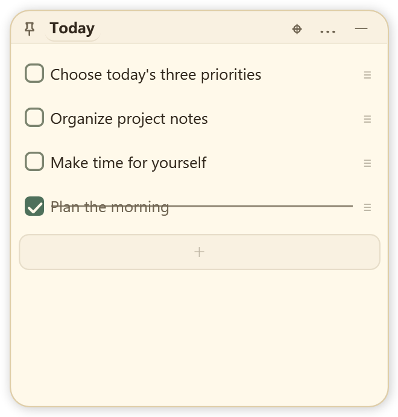
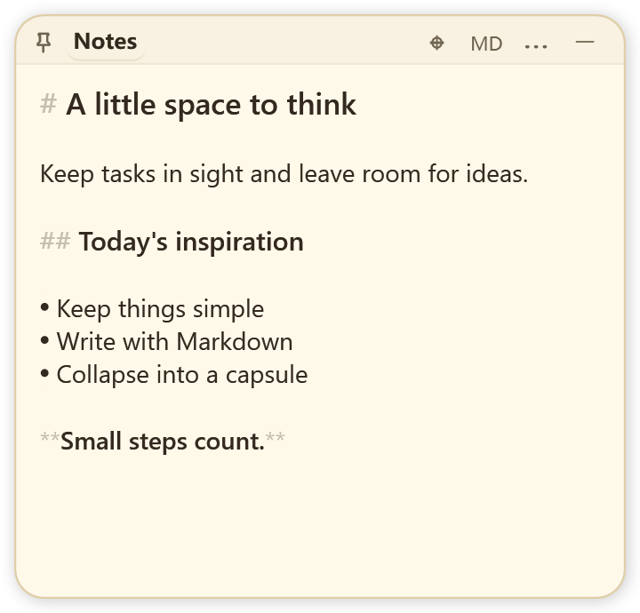

<p align="center"></p>

<p align="center">
  <a href="https://github.com/seiya058904/dodo/releases/latest"></a>
  
  
  <a href="LICENSE.md"></a>
</p>

<h3 align="center">A few useful papers. A little more breathing room.</h3>
<p align="center">Native Windows notes and to-dos that tuck into edge capsules.<br>Local files, portable backups, and a small, slightly bewildered bird.</p>
<p align="center"><a href="https://github.com/seiya058904/dodo/releases/latest"><strong>↓ Download Dodo for Windows</strong></a> · <a href="README.zh.md">简体中文</a> · <a href="https://github.com/seiya058904/dodo/issues">Feedback</a></p>

## Your desktop, with room to think

<table><tr><td width="48%"></td><td></td></tr></table>
<p align="center"></p>

| Make a little list | Leave a little note | Tuck it away |
| :--- | :--- | :--- |
| Check things off, reorder, undo, and set reminders. | Write lightweight Markdown and paste local images. | Collapse a paper into an edge capsule; see what's left at a glance. |

<details><summary>After hours · dark theme</summary>
<table><tr><td width="48%"></td><td></td></tr></table>
</details>

<sub>These previews are rendered from the actual WPF controls with the included offscreen visual-review tool. They do not represent native desktop/DWM capture. Desktop acceptance is tracked in the verification record.</sub>

## What's different in Dodo?

Dodo builds on **[PaperTodo](https://github.com/snownico0722/PaperTodo)**. Its native papers,
edge docking, Markdown editor, undo, search, multilingual UI, plugin system, and MCP
integration come from that project. Dodo adds a focused set of everyday improvements:

- **A count that stays out of the way.** Built-in to-do capsules show unfinished items, such as `Work · 3`. Zero disappears; the count can be disabled in Settings.
- **A complete way out — and back in.** A versioned ZIP includes papers, the LMDB image store, settings, host-managed plugin state, and supported custom resources. Restore validates the archive, keeps your previous data, and replaces the profile safely.
- **Markdown you can keep.** Export a note or checklist to a chosen `.md` file. Checkboxes retain completion; images use relative paths in an accompanying folder.
- **A quieter identity.** Dodo has its own executable, data directory, startup registration, single-instance signals, and MCP pipe. The upstream telemetry sender and reporting tasks have been removed.
- **A gentler finish.** A small Dodo mascot, sage accents, more readable secondary text, and coordinated light/dark styling keep the paper feeling intact.

English, Simplified Chinese, Japanese, and Korean are available. Edge hover previews,
third-party plugins, and MCP retain their upstream **preview** status.

## Download & start

1. Download **`Dodo-v0.1.0-win-x64-portable.zip`** from [Releases](https://github.com/seiya058904/dodo/releases/latest).
2. Extract the **whole ZIP** to a writable folder and run **`Dodo.exe`**. The recommended package includes the .NET runtime.
3. Your profile lives beside the executable in **`dodo-data/`**. Keep that folder when updating the application files.

Windows x64 is required. The project targets Windows 10 version 1809 or later;
current Windows 10/11 is recommended. Unsigned builds may show a Windows reputation
prompt. A `no-runtime` package, when provided, requires **.NET 10 Desktop Runtime x64**.

The portable package includes the native **Focus Timer** and **Sample Clock** plugins.
Other plugin samples in the source repository are not automatically bundled. Web
plugins additionally require Microsoft's **WebView2 Evergreen Runtime**. Native
notes, to-dos, and the bundled native plugins do not require WebView2.

| Everyday action | How |
| :--- | :--- |
| Collapse a paper | Top-right button or `Ctrl+W` |
| Undo / redo | `Ctrl+Z` / `Ctrl+Y` |
| Find a paper or text | Search from the tray menu |
| Recover papers covered by other windows | Double-click the tray icon |
| Export Markdown | Paper menu **⋯ → Export Markdown…** |
| Back up or restore | **Settings → General → Backup and restore** |

## Your data, in your hands

**Backups are replacements, not merges.** Export a ZIP outside `dodo-data/`. Before
restoring, Dodo checks the format, version, file hashes, safe paths, image references,
and plugin-state files, then displays a summary for confirmation. It saves the old
profile under `dodo-data/restore-history/`, applies the replacement, and exits.
Reopen Dodo to use the restored profile. An interrupted restore is rolled back on
the next startup before the profile is loaded.

Backups include `data.json`, its recovery snapshot, `note-assets.lmdb`, host-managed
`plugins/data/*.json`, background preferences, and supported `dodo.*` image/font/sound/icon
resources. They **do not** include plugin programs, plugin-owned external databases,
linked files outside the profile, caches, or older restore-history folders. The
confirmation lists required plugins; reinstall missing plugin programs before using
their restored state. Treat backups as private: they contain your notes and plugin settings.

**Markdown export is one-way.** Keep the `.md` and its `dodo-assets-…` folder together
when moving an export. Exporting the same filename again asks before replacing the
document and uses a fresh asset folder, preserving previous exports' images. Dodo
does not watch exported files or import edits back into the application.

Dodo never imports an existing PaperTodo profile automatically. It can coexist with
PaperTodo, and GitHub synchronization concerns source code only — there is no note
cloud sync, account, or hosted service in this release.

## Build from source

Use Windows, PowerShell 7, Git, and the **.NET 10 SDK**:

```powershell
git clone --recurse-submodules https://github.com/seiya058904/dodo.git
cd dodo
dotnet build PaperTodo.csproj -c Release
```

The project filename and `PaperTodo` namespaces remain intentional compatibility
boundaries; the output is `Dodo.exe`. Preserve Git history and the pinned submodule.
If needed, run `git submodule update --init --recursive`. GitHub's automatic source
ZIPs omit submodule contents and are not complete standalone build packages.

```powershell
# Relevant behavior checks; some groups create native test windows.
./tools/testing/Run-Checks.ps1 -Group persistence
dotnet run --project tests/PaperTodo.EdgeTitleChecks -c Release -- --todo-count-only
dotnet run --project tests/PaperTodo.MarkdownEditingChecks -c Release -- --export

# Full portable package; see the script's parameters for optional variants.
./tools/Release.ps1
```

Release CI rebuilds native LMDB from the included source, requiring CMake and the
Visual C++ toolchain. Ordinary local builds use the pinned native library. Release
publication is a manual workflow after checks and desktop acceptance; pushing a
tag alone does not publish a release. Packages include `SHA256SUMS.txt` on the Release page.

See [verification notes](doc/DODO-VERIFICATION.md), [architecture](doc/ARCHITECTURE.md),
[plugin documentation](plugin-samples/README.md), and the [changelog](CHANGELOG.md).

## Acknowledgements & license

Dodo is a **noncommercial, source-available derivative of PaperTodo**, based on
upstream commit `411078b094f9a22c15ffb2722f0b1cc7d0af0537` (`4.0.0-beta1`), with
its original history and authorship retained. Dodo's `0.1.0` is an independent
version sequence, not a claim that every upstream preview feature is production-stable.

Thank you to **snownico0722** and the PaperTodo contributors for the paper-first
design and native foundation. Read the complete unchanged [license](LICENSE.md),
[Required Notice](REQUIRED-NOTICE.md), and [third-party notices](THIRD-PARTY-NOTICES.md).
The terms are **PolyForm Noncommercial 1.0.0** plus **PaperTodo Individual Professional
Use Additional Permission 1.0**. This is not an MIT-licensed or OSI-approved
open-source project; organizational deployment has separate restrictions in the full terms.

---

<!-- BEGIN GENERATED CHINESE README -->
<details>
<summary>简体中文（点击展开完整 README）</summary>

# Dodo · 给桌面留一点空白

[English](README.md) · [下载 Windows 版](https://github.com/seiya058904/dodo/releases/latest) · [问题反馈](https://github.com/seiya058904/dodo/issues)


Dodo 是基于 [PaperTodo](https://github.com/snownico0722/PaperTodo) 的非商业衍生桌面工具。
保留原生纸片、待办、Markdown、贴边胶囊、搜索、多语言、插件与 MCP，并加上一只安静呆萌的渡渡鸟。

## 首版改进

- 待办胶囊显示未完成数量，例如“工作 · 3”。完成、删除和撤销即时更新；数量为零时隐藏，也可在设置关闭。
- 设置中导出完整 ZIP 备份，覆盖纸片、LMDB 图片、设置、宿主管理的插件状态和支持的自定义资源。
- 恢复前校验格式、版本、哈希、图片引用和安全路径，展示清单；采用替换语义，旧数据留在 `restore-history`，失败或中断可回滚。
- 纸片菜单正式导出 `.md`，待办保留勾选状态，图片使用相对路径。移动时把图片文件夹和 `.md` 一起移动。
- 独立程序、数据目录、启动项、单实例与 MCP 身份；移除了上游遥测发送器和上报任务。
- 渡渡鸟图标、柔和鼠尾草绿点缀与浅深主题次要文字对比度改进。

## 下载运行

下载 `Dodo-v0.1.0-win-x64-portable.zip`，完整解压到可写目录，运行 `Dodo.exe`。
推荐包自带 .NET；可选的 `no-runtime` 包需要 .NET 10 Desktop Runtime x64。
数据存放在程序旁的 `dodo-data/`，升级时保留它。Windows 10 1809 及以上 x64 可构建运行，推荐当前 Windows 10/11。

便携包包含原生 Focus Timer 和 Sample Clock 插件。仓库中其他插件不会自动随包提供。
Web 插件额外依赖 WebView2 Evergreen Runtime。插件、MCP 与边缘悬停预览保留上游预览功能属性。

## 备份与导出

入口：**设置 → 常规 → 备份与恢复**；Markdown 导出位于纸片的 **⋯ 菜单**。

备份包括 `data.json`、恢复快照、`note-assets.lmdb`、`plugins/data/*.json`、背景偏好和支持的 `dodo.*` 自定义图片、字体、音效、图标。
不含插件程序、插件自行管理的外部数据库、外部链接文件、缓存和旧恢复历史。恢复确认列出所需插件，缺失时需另行安装。
恢复会替换当前资料而不合并；保留恢复前副本后退出，重新打开 Dodo 即可。启动会优先回滚未完成的恢复。

Markdown 是单向导出，不回写。覆盖同名文档前会确认，每次图片导出使用新的独立目录，旧图片不会自动删除。
Dodo 不自动读取原版 PaperTodo 数据，也不提供便签云同步、账号系统或服务端。

## 构建

需要 Windows、PowerShell 7、Git 和 .NET 10 SDK：

```powershell
git clone --recurse-submodules https://github.com/seiya058904/dodo.git
cd dodo
dotnet build PaperTodo.csproj -c Release
```

项目文件与内部 `PaperTodo` 命名保留兼容边界，输出为 `Dodo.exe`。
必须保留完整 Git 历史与固定子模块。GitHub 自动源码 ZIP 不包含子模块，不能作为完整独立构建包。
完整发布包由 `tools/Release.ps1` 生成；Release CI 从源码重建 LMDB，需要 CMake 与 Visual C++ 工具链。

[验收记录](doc/DODO-VERIFICATION.md) · [更新日志](CHANGELOG.zh.md) · [插件文档](plugin-samples/README.zh.md)

## 出处与许可

基于 PaperTodo `4.0.0-beta1` 主线提交 `411078b094f9a22c15ffb2722f0b1cc7d0af0537`。
感谢原作者 **snownico0722** 与贡献者。Dodo 使用独立版本序列，并不意味着上游全部预览功能已验证稳定。

保留完整 [LICENSE.md](LICENSE.md)、[Required Notice](REQUIRED-NOTICE.md) 与第三方许可。
适用 PolyForm Noncommercial 1.0.0 及 PaperTodo Individual Professional Use Additional Permission 1.0。
这是非商业、源码可用的衍生版本，不是 MIT，也不是 OSI 认可的开源许可。个人工作使用与组织部署请查阅完整条款。

</details>
<!-- END GENERATED CHINESE README -->
