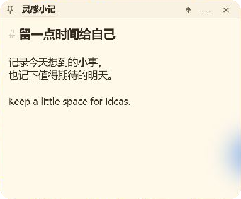

# Dodo · 给桌面留一点空白

[English](README.md) · [下载 Windows 版](https://github.com/seiya058904/dodo/releases/latest) · [问题反馈](https://github.com/seiya058904/dodo/issues)


Dodo 是基于 [PaperTodo](https://github.com/snownico0722/PaperTodo) 的非商业衍生桌面工具。
保留原生纸片、待办、Markdown、贴边胶囊、搜索、多语言、插件与 MCP，并加上一只安静呆萌的渡渡鸟。

<table><tr><td></td><td></td></tr></table>

以上为真实 Windows 窗口截图，仅裁切并遮去周围桌面。实机覆盖范围和工具限制见[验收记录](doc/DODO-VERIFICATION.md)。

## 首版改进

- 待办胶囊显示未完成数量，例如“工作 · 3”。完成、删除和撤销即时更新；数量为零时隐藏，也可在设置关闭。
- 设置中导出完整 ZIP 备份，覆盖纸片、LMDB 图片、设置、宿主管理的插件状态和支持的自定义资源。
- 恢复前校验格式、版本、哈希、图片引用和安全路径，展示清单；采用替换语义，旧数据留在 `restore-history`，失败或中断可回滚。
- 纸片菜单正式导出 `.md`，待办保留勾选状态，图片使用相对路径。移动时把图片文件夹和 `.md` 一起移动。
- 独立程序、数据目录、启动项、单实例与 MCP 身份；移除了上游遥测发送器和上报任务。
- 渡渡鸟图标、柔和鼠尾草绿点缀与浅深主题次要文字对比度改进。

## 下载运行

下载 `Dodo-v0.1.0-win-x64-portable.zip`，完整解压到可写目录，运行 `Dodo.exe`。
推荐包自带 .NET；可选的 `no-runtime` 包需要 .NET 10 Desktop Runtime x64。
数据存放在程序旁的 `dodo-data/`，升级时保留它。需要 Windows x64；Windows API 目标为 Windows 10 1809，实际运行时系统支持范围以微软的 [.NET 10 支持矩阵](https://github.com/dotnet/core/blob/main/release-notes/10.0/supported-os.md)为准。本次本地验证使用 Windows 11，尚未单独验收 Windows 10。

便携包包含原生 Focus Timer 和 Sample Clock 插件。仓库中其他插件不会自动随包提供。
Web 插件额外依赖 WebView2 Evergreen Runtime。插件、MCP 与边缘悬停预览保留上游预览功能属性。

## 备份与导出

入口：**设置 → 常规 → 备份与恢复**；Markdown 导出位于纸片的 **⋯ 菜单**。

备份包括 `data.json`、恢复快照、`note-assets.lmdb`、`plugins/data/*.json`、背景偏好和支持的 `dodo.*` 自定义图片、字体、音效、图标。
不含插件程序、插件自行管理的外部数据库、外部链接文件、缓存和旧恢复历史。恢复确认列出所需插件，缺失时需另行安装。
恢复会替换当前资料而不合并；保留恢复前副本后退出，重新打开 Dodo 即可。启动会优先回滚未完成的恢复。

Markdown 是单向导出，不回写。覆盖同名文档前会确认，每次图片导出使用新的独立目录，旧图片不会自动删除。
Dodo 不自动读取原版 PaperTodo 数据，也不提供便签云同步、账号系统或服务端。

## 构建

需要 Windows、PowerShell 7、Git 和 .NET 10 SDK：

```powershell
git clone --recurse-submodules https://github.com/seiya058904/dodo.git
cd dodo
dotnet build PaperTodo.csproj -c Release
```

项目文件与内部 `PaperTodo` 命名保留兼容边界，输出为 `Dodo.exe`。
必须保留完整 Git 历史与固定子模块。GitHub 自动源码 ZIP 不包含子模块，不能作为完整独立构建包。
完整发布包由 `tools/Release.ps1` 生成；Release CI 从源码重建 LMDB，需要 CMake 与 Visual C++ 工具链。

[验收记录](doc/DODO-VERIFICATION.md) · [更新日志](CHANGELOG.zh.md) · [插件文档](plugin-samples/README.zh.md)

## 出处与许可

基于 PaperTodo `4.0.0-beta1` 主线提交 `411078b094f9a22c15ffb2722f0b1cc7d0af0537`。
感谢原作者 **snownico0722** 与贡献者。Dodo 使用独立版本序列，并不意味着上游全部预览功能已验证稳定。

保留完整 [LICENSE.md](LICENSE.md)、[Required Notice](REQUIRED-NOTICE.md) 与第三方许可。
适用 PolyForm Noncommercial 1.0.0 及 PaperTodo Individual Professional Use Additional Permission 1.0。
这是非商业、源码可用的衍生版本，不是 MIT，也不是 OSI 认可的开源许可。个人工作使用与组织部署请查阅完整条款。
